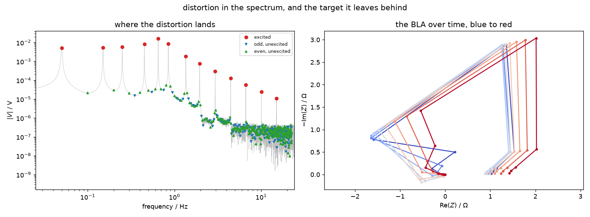

# Designing the excitation

Most of what limits a time-varying impedance measurement is decided before any
data exists. This page collects those decisions.

## Odd harmonics, with gaps

The excitation used throughout this package is a multisine on **odd harmonics
of $1/T_p$, on a quasi-logarithmic grid**:

```python
harmonics = np.array([1, 3, 5, 9, 13, 17, 27, 39, 59, 89, 133, 201, 301])
frequencies = harmonics / Tp          # 0.05 ... 15.05 Hz for Tp = 20 s
```

Three separate choices are bundled there.

**Logarithmic spacing**, because that is how electrochemical features are
distributed — a cell has decades of relevant behaviour, not a linear sweep of
it. Fifteen tones over three decades is roughly what one acquisition can
practically deliver.

**Odd harmonics**, because even-order distortion then lands on even bins,
which no tone occupies. You can measure it instead of guessing at it. This is
exact, not approximate: in the block-oriented example, the branch whose
nonlinearity is $x + 0.08x^2$ — an even function — shifts the best linear
approximation by $10^{-16}$, machine zero, at every drive amplitude. An even
nonlinearity driven by odd harmonics simply cannot reach an excited bin.

**Gaps**, because odd-order distortion lands on the odd harmonics you skipped.
With a sparse grid, most harmonic bins are free, and their level is a direct
measurement of how far from linear the cell is.

!!! note "Where the distortion goes"
    In example 03, of the harmonic bins up to $1.5 \times h_{\max}$: 13 are
    excited, 212 are unexcited odd, 225 unexcited even. The unexcited bins sit
    about $10^{-4}$ of the excited level, which is the distortion floor of that
    system.



*Left: the voltage spectrum, with excited tones, unexcited odd bins and
unexcited even bins marked separately. The gaps in the grid are what make the
distortion measurable.*

## Whole periods

The record must hold an **integer number of multisine periods**. A fractional
period leaks each spectral line into its neighbours, and that leakage is
mathematically the same shape as the skirt produced by genuine time variation.
No method can separate them.

`bltva` refuses a non-integer record. STFT and DMFA will not complain, so trim
the record yourself.

## How many periods, $P$

This is the decision that sets everything else for BLTVA, because the model
orders share a budget fixed by $P$:

\[
N_q + 3N_p + N_a + 1 \;<\; 2P - 1
\]

with $N_a$ itself determined by $P$ and $N_p$. Substituting one into the other
leaves $N_p < 0.625P - 4$ at fixed $N_q$, so the number of periods caps the
model order, and the model order caps how fast a variation can be followed.

Measuring longer helps, but with diminishing returns: the record grows linearly
in $P$ while the affordable $N_p$ grows more slowly, so the ratio converges.

!!! warning "eq. (49) is necessary, not sufficient"
    A configuration can satisfy the inequality and still be refused, because
    Algorithm 1 estimates the noise from a sliding band that needs strictly
    more equations than regressors. On a 6-period record, $N_p = 2$ with
    $N_q = 2$ passes eq. (49) and is then rejected with exactly 10 regressors
    for 10 equations. See [implementation notes](../implementation/bltva.md#eq-49-is-necessary-not-sufficient).

## Amplitude

Two effects pull in opposite directions:

- **Too small** and the response is noise-limited, particularly at the top of
  the grid where $|Z|$ is smallest.
- **Too large** and the cell distorts, which moves the best linear
  approximation — the target itself — as shown in
  [when is $Z(f,t)$ meaningful](when-meaningful.md#2-the-system-must-be-close-enough-to-linear).

There is therefore a minimum total error at a finite amplitude, neither the
smallest nor the largest you can apply. If you use BLTVA with
`harmonics="all_nl"`, its SNDR tells you which side of that minimum you are on.

## Choosing the frequency range

Put the grid where the cell responds. Two checks:

- **Bracket the feature you care about.** For an $R\|C$ arc the apex sits at
  $f = 1/(2\pi R_{ct}C)$; a grid that stops below it gives a fragment of a
  semicircle that an equivalent-circuit fit will happily misinterpret.
- **Do not extend past where the response has rolled off.** In the
  block-oriented example the branch filters roll off near 1 Hz, so by 15 Hz
  $|G_0|$ has fallen by a factor of 1484 and the relative error there is
  measuring the signal-to-noise ratio, not the estimator.

Raising the lowest frequency is also the only way to shorten the
time-resolution floor in seconds, so the grid and the tracking speed are the
same decision.
