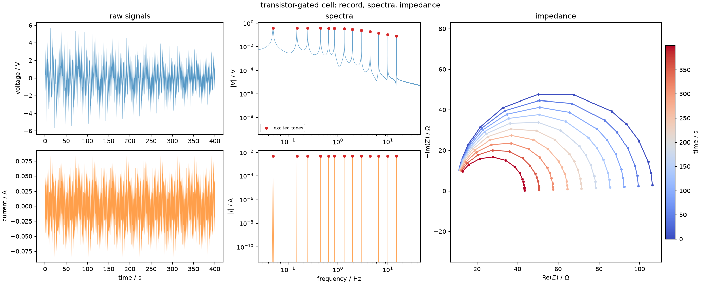

# The signal model

This package sits between two fields that use different words for the same
things. Electrochemistry speaks of impedance, cells and spectra; system theory
speaks of transfer functions, plants and frequency responses. The code and the
source papers use the system-theory vocabulary, so this page gives the
translation first.

## Notation

| symbol | meaning | notes |
|---|---|---|
| $u(t)$, $y(t)$ | excitation and response | here current and voltage, so $Z = Y/U$ |
| $Z(f,t)$ | the time-varying impedance | the quantity every estimator tries to recover |
| $f_k$ | the $k$-th excited frequency | Hz |
| $T_p$ | period of the multisine | s; $f_{\min} = 1/T_p$ |
| $P$ | number of periods in the record | the single most consequential choice |
| $N$ | samples in the record | $N = P \cdot f_s T_p$ |
| $T$ | record duration | $T = N/f_s = P \cdot T_p$ |
| $f_s$ | sampling rate | Hz |
| $k$ | DFT bin index | bins are $1/T$ apart |
| $h$ | harmonic number | tone $h$ sits at bin $h \cdot P$ |
| $b_p(t)$ | the $p$-th Legendre basis function | $b_p(t) = L_p(2t/T - 1)$ |
| $H_p(f)$ | the $p$-th coefficient of $Z(f,t)$ | what BLTVA estimates |
| $N_p$ | order of the Legendre expansion | how much time structure the model can express |
| $N_q$ | order of the trend polynomial at DC | how much drift it can absorb |
| $N_a$ | order of the transient polynomial per band | chosen automatically |

A note on $h$ versus $k$ that causes real confusion: `bltva` takes **harmonic
numbers**, not frequencies and not bin indices. Harmonic $h$ of a $P$-period
record occupies DFT bin $h \cdot P$. So $f_{\min}$, one harmonic, is $P$ bins
wide in the spectrum — a fact that matters when choosing bandwidths and band
widths.

## The model

A time-invariant system has one transfer function. A time-varying one does
not, and the model this package uses expands it in time:

\[
Z(f, t) \;=\; \sum_{p=0}^{N_p} H_p(f)\, b_p(t)
\]

with $b_p$ the Legendre polynomials on the record, rescaled so that
$b_p(t) = L_p(2t/T - 1)$.

Two properties make this a convenient basis rather than an arbitrary one:

- $b_0 \equiv 1$, and every higher order has **zero mean**. So $H_0(f)$ is the
  time-averaged impedance — the best stationary approximation of a cell that
  was not stationary — and every higher coefficient describes only change.
- The basis functions are **real**. That is what makes the frozen-time
  synthesis exact for a linear time-varying system: because $b_p(t)$ is real,
  the sum over $p$ and the sum over excited tones commute, so evaluating the
  stationary formula at each instant gives the same answer as the full
  time-varying convolution. This is why `simulate_legendre` can produce an
  exactly-known time-varying ground truth without integrating anything.

!!! note "The convention has to be shared"
    The simulator and the estimator import the same `legendre_basis` from
    `deistools.processing.bltva`. If they used different mean-removal
    conventions, a comparison between them would measure the convention and
    not the estimator. See [conventions](../implementation/bltva.md#the-legendre-basis-convention).

## Skirts

This is the idea everything in the frequency domain rests on.

For a **stationary** system, a periodic excitation produces a response
concentrated entirely on the excited DFT bins. Nothing lands in between.

For a **time-varying** system, the response at each tone is modulated by
$Z(f_k, t)$. Multiplication in time is convolution in frequency, so each
excited line is smeared into its neighbouring bins — a *skirt*. The shape of
that skirt is the spectrum of the variation.

That has two consequences:

1. **The skirts are the data.** They are where the information about how the
   system changed actually lives. STFT ignores them; DMFA filters a band that
   contains them; BLTVA fits them explicitly.
2. **Leakage is indistinguishable from time variation.** A record holding a
   non-integer number of periods also smears each line into its neighbours. No
   estimator can tell the two apart, which is why the integer-period
   requirement is not pedantry.

You can see the skirts directly in the voltage spectrum of any time-varying
example — the second column of the standard three-panel figure. The current
spectrum has none, because the excitation is exactly periodic.

*The standard three-panel view, from `01_synth_transistor.py`. Left: the
voltage envelope narrows as $R_{ct}$ falls. Middle: each voltage tone has
grown skirts, while the current tones have none. Right: the impedance at a
series of instants, blue to red.*

## What each method does with them

| method | domain | what it does |
|---|---|---|
| **STFT** | time | cuts the record into windows and transforms each. Skirts are not used; the time resolution is the window length |
| **DMFA** | frequency | filters a band around each tone and transforms it back. Band width sets the time resolution |
| **BLTVA** | frequency | fits a model of the skirts, band by band, and returns the coefficients $H_p$ |

The three differ in what they assume, which is the subject of the
[Methods](../methods/stft.md) pages.
