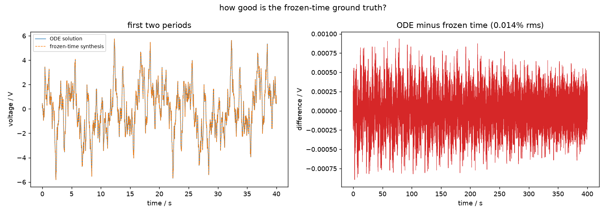

# When is $Z(f,t)$ meaningful?

Before asking which estimator to use, it is worth asking whether the quantity
they all estimate exists for your system. Two conditions have to hold, and
both can be checked.

## 1. The system must change slowly compared with its own dynamics

"The impedance at time $t$" means: the impedance the cell *would* have if it
were frozen in the state it is in at time $t$. This is the **frozen-time** or
quasi-static impedance, and it is an approximation to what a time-varying
system actually does.

The approximation is good when the system changes little during one of its own
time constants. For an $R_s + (R_{ct}\|C)$ cell the useful dimensionless
measure is

\[
\frac{\Delta R_{ct}}{R_{ct}} \quad\text{per time constant } \tau = R_{ct}C
\]

In the transistor example the gate ramp changes $R_{ct}$ by **0.016 %** of
itself per time constant, and the frozen-time synthesis then differs from the
true ODE solution by **0.014 % rms** — the two agree, as they should.

The practical consequence: if your cell changes appreciably within one $RC$
time, no estimator here is wrong so much as answering a question that does not
have an answer. The output will still look reasonable.

!!! tip "You can check this on your own system"
    `simulate_r_rc_transistor` returns both `voltage_V` (the integrated ODE)
    and `voltage_quasistatic_V` (the frozen-time synthesis). The rms difference
    between them is the size of the approximation at your ramp rate. Example 01
    does exactly this.

*Left: the two responses over the first two periods, indistinguishable at this
scale. Right: their difference, 0.014 % rms.*

## 2. The system must be close enough to linear

A nonlinear system has no transfer function at all. What an estimator returns
is then a **best linear approximation** (BLA): the transfer function a linear
model converges to *under that particular excitation*, at that particular
amplitude.

This is not a technicality. In the block-oriented example, doubling the drive
moves the ground truth by $3.2\times10^{-5}$ relative, against a best
estimator error of $9.4\times10^{-5}$ — a factor of three apart. At four times
the drive the shift *overtakes* the estimator error, because it grows with
amplitude while the estimator error does not.

So:

- An impedance reported without its excitation amplitude is incomplete
  whenever the cell is not strictly linear.
- Results are comparable only at fixed drive.
- BLTVA can measure how much of its residual is distortion rather than noise.
  See [distortion](../methods/bltva.md#distortion-and-sndr).

## The time-resolution floor

Even when both conditions hold, there is a limit on how finely time can be
resolved, and it differs by method:

| method | finest resolution | set by |
|---|---|---|
| STFT | one multisine period | the lowest tone must fit in the window |
| DMFA | $\approx 1/\mathrm{bandwidth}$ | capped by the spacing of your tones |
| BLTVA | no fixed instant grid | the model order affordable at your $P$ |

STFT's floor is hard: nothing recovers detail finer than one period of the
lowest tone. DMFA's is set by how wide a band the filter can take before it
reaches the neighbouring tone, which is a property of your frequency grid
rather than of the method. BLTVA returns a continuous function of time, so its
limit is the finest feature a polynomial of the affordable order can describe.

All three therefore push in the same direction: **if you need fine time
resolution, raise your lowest frequency.** A 10 mHz tone fixes STFT's
resolution at 100 s whatever else you do.

## The bottom decade is always the worst

In every comparison in this package, on every system, the largest relative
errors sit at the lowest frequencies. The cause is shared, even though the
mechanism differs by method.

What matters is how many cycles of a tone fit inside the time the cell takes
to change. In the transistor example the 0.05 Hz tone completes 20 cycles over
the whole variation while the 15 Hz tone completes 6020. The low tone is being
asked to measure an impedance that changes noticeably within a single period
of itself.

If you fit an equivalent circuit to a time-varying spectrum, weight the bottom
decade accordingly.
