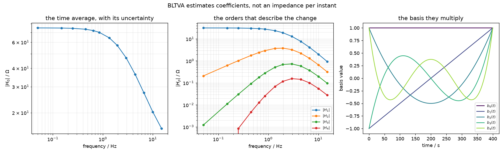
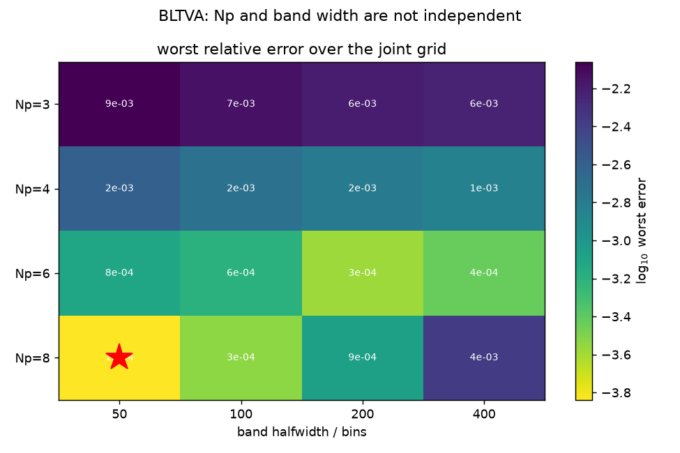
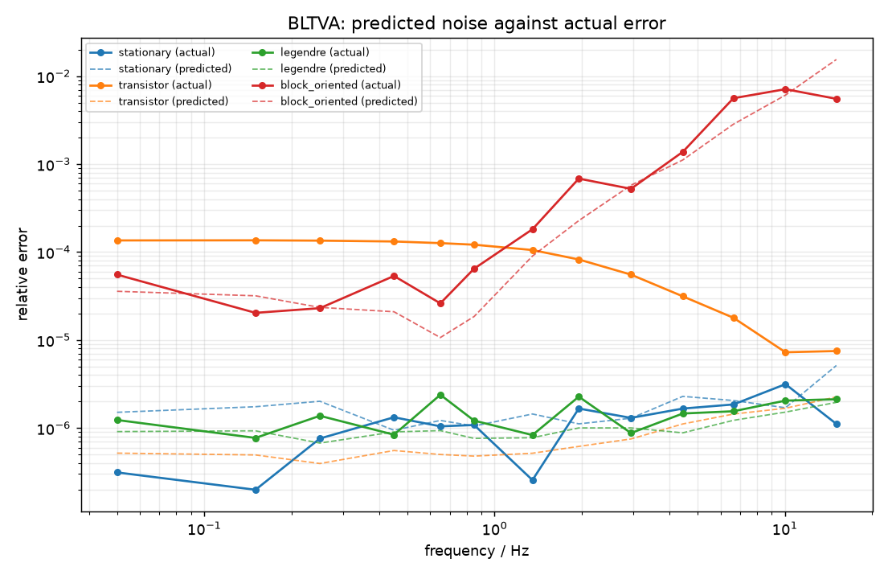
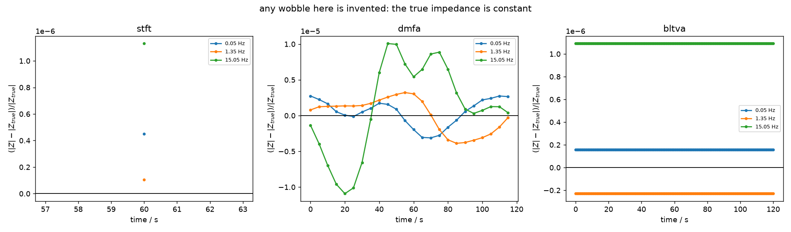

# BLTVA

Best linear time-varying approximation. BLTVA assumes a *form* for the
variation,

\[
Z(f, t) \;=\; \sum_{p=0}^{N_p} H_p(f)\, b_p(t)
\]

and fits the coefficients $H_p$ directly in the frequency domain, band by
band. Instead of cutting the record or filtering a band it uses the
[skirts](../concepts/signal-model.md#skirts) as its data.

It is the most accurate of the three when its assumption holds, and the only
one that reports an uncertainty.

## Calling it

```python
from deistools.processing.bltva import bltva, legendre_basis

result = bltva(
    voltage, current, fs, P,
    harmonics,              # excited HARMONIC NUMBERS, not frequencies
    Np=8,                   # order of the Legendre expansion of Z(f,t)
    Nq=2,                   # order of the trend polynomial at DC
    Na=None,                # transient order: chosen automatically
    harmonics="excited",    # or "all_nl" to keep the unexcited harmonic bins
    band_halfwidth=50,      # DFT bins either side of each tone
)
```

!!! note "Harmonic numbers, not frequencies"
    `bltva` works in DFT bins throughout, so it takes integers. Harmonic $h$
    of a $P$-period record occupies bin $h \cdot P$.

### What comes back

`BLTVAResult` holds coefficients, not an impedance per instant:

| field | shape | meaning |
|---|---|---|
| `H_p` | `(n_freq, Np+1)` | the coefficients. `H_p[:, 0]` is the time average |
| `f_exc` | `(n_freq,)` | the excited frequencies |
| `std_H_p` | `(n_freq, Np+1)` | uncertainty on each coefficient |
| `diagnostics` | list | one entry per band fitted |
| `var_distortion_even/odd` | `(n_freq, Np+1)` | only with `harmonics="all_nl"` |

To get an impedance, evaluate the model wherever you want it:

```python
Z = result.H_p @ legendre_basis(N, Np).T        # (n_freq, N)
```

It is a smooth polynomial, so 200 instants carry the same information as all
400 000 samples.



*Left: the time average with its uncertainty. Middle: the orders that describe
the change, each falling about an order of magnitude below the last. Right:
the basis functions they multiply.*

## The parameters

### $N_p$ — the order of the expansion

The one that matters. Under-specify and the error hits a floor that no amount
of signal quality moves; over-specify and almost nothing happens, because
coefficients the data does not support are pruned away.

| $N_p$ | median | worst |
|---|---|---|
| 1 | 1.04e-02 | 1.11e-01 |
| 2 | 1.20e-03 | 2.66e-02 |
| 4 | 1.29e-04 | 1.88e-03 |
| 8 | 1.02e-04 | 2.91e-04 |

*(transistor system, example 14)*

**Err high.** The two mistakes are not symmetric.

### $N_q$ — the trend order

Insurance against drift, and it does nothing if there is none. On the
transistor circuit — which changes its impedance but not its DC level — $N_q$
makes no difference at all.

Add an order-3 voltage trend of 5 V peak-to-peak, and it does:

| $N_q$ | median | worst |
|---|---|---|
| 0 | 1.33e-04 | 9.28e-01 |
| 1 | 1.33e-04 | 1.36e-01 |
| 2 | 1.32e-04 | 1.02e-02 |
| 3 | 1.29e-04 | 1.88e-03 |

It matters in the **worst case**, not the median, because a trend is a
disturbance near DC that corrupts the lowest tones and leaves the rest alone.
It saturates exactly at the order of the trend present.

!!! note "Detrending is specific to BLTVA"
    `Nq` and the differencing of
    [`deistools.processing.detrending`](../api/processing.md) exist because
    BLTVA *models* the trend and differencing reduces the number of
    coefficients that takes. DMFA has no trend model -- it rejects the trend
    with its filter's stopband instead -- so neither idea carries over, and
    differencing is in fact the weakest of the options there. See
    [DMFA and trends](dmfa.md#trends-why-bltvas-detrending-does-not-transfer).

### `band_halfwidth` — and why it is not independent of $N_p$

Bands are *meant* to overlap: the default rule spans three consecutive excited
frequencies deliberately. A skirt whose centre lies inside the band gets its
own block of regressors and is fitted explicitly; one outside contributes only
a tail, which is nearly collinear with the transient polynomial and cannot be
separated from it.

But the two parameters interact, and the sign of the effect flips:

| | band 50 | band 100 | band 200 | band 400 |
|---|---|---|---|---|
| $N_p = 3$ | 8.70e-03 | 7.13e-03 | 6.33e-03 | **5.92e-03** |
| $N_p = 4$ | 2.48e-03 | 1.88e-03 | 1.58e-03 | **1.43e-03** |
| $N_p = 6$ | 7.70e-04 | 6.33e-04 | **2.65e-04** | 3.76e-04 |
| $N_p = 8$ | **1.45e-04** | 2.91e-04 | 8.51e-04 | 4.26e-03 |

*(worst relative error; example 14)*



Tuning them separately picks $N_p = 8$, band 400 — **29× worse** than the
joint optimum. The cause is explained in the
[implementation notes](../implementation/bltva.md#n_p-and-the-band-width-compete-for-n_a).

**Raise $N_p$ and you must narrow the band.**

### $N_a$ — leave it at `None`

Chosen by a closed-form rule from $P$, $N_p$ and the detrending order. A
hand-picked value was 19× worse in testing, and the curve is monotone, so
there is no optimum to hunt for.

## The uncertainty is a model-error detector

BLTVA estimates the noise from bins the excitation never touched and
propagates it to the coefficients. That gives a predicted $\sigma$ which
covers **noise only** — so comparing it with the error you actually see tells
you which of the two is limiting you:

| system | actual median | predicted noise | ratio |
|---|---|---|---|
| stationary | 1.11e-06 | 1.51e-06 | 0.7 |
| legendre | 1.30e-06 | 9.31e-07 | 1.4 |
| block-oriented | 1.71e-04 | 9.01e-05 | 1.9 |
| **transistor** | 1.06e-04 | 5.56e-07 | **190** |

Three of the four sit near one, because those systems have no model error to
have — nothing varies, or the Legendre model is exactly right, or the excess
is genuine distortion. The transistor is the outlier because its $Z(f,t)$ is a
rational function of time, not a polynomial, so a Legendre series approximates
it and leaves a residue.

**Practical use:** compare the reported $\sigma$ with your own repeatability.
If your error is far larger, more averaging will not help — raise $N_p$ or
change method.



*Solid: the error actually made. Dashed: what noise alone predicts. They
coincide except on the transistor, where the model is the limit.*

## Pruning: it can say "stationary"

Coefficients the data does not support are removed from the fit rather than
left to absorb noise. On a stationary cell, BLTVA's time-varying coefficient
comes back as **exactly zero at every tone** — not small, absent. On the
transistor record the same coefficient is 0.37 of $|H_0|$.

That is a different kind of answer from "the variation I measured was small",
and it is worth having.



*The true impedance is constant, so every wobble here is invented. BLTVA's
panel is flat at machine precision because the coefficient was pruned away.*

## Distortion and SNDR

With `harmonics="all_nl"` the fit keeps the unexcited harmonic bins, and the
parity of those bins separates even-order from odd-order distortion. The
result then offers `var_distortion_even`, `var_distortion_odd` and
`sndr_db()` — the signal-to-noise-and-distortion ratio, i.e. how far the
linear part stands above everything that is not it.

On the block-oriented system SNDR runs 24 to 76 dB across the grid, falling
where the branch filters have rolled off. It is the number to check before
trusting an impedance from a cell driven hard enough to distort, and neither
STFT nor DMFA computes it.

`harmonics="all_nl"` also improved the estimate there, from 1.7e-04 to
9.5e-05, because the nonlinear harmonics are modelled instead of being left to
disturb the bands they fall in. On a linear system there is nothing there to
model and nothing to gain.

## Inspecting a fit

```python
from deistools.processing.bltva import visualize_bltva_fit

visualize_bltva_fit(voltage, current, fs, P, harmonics,
                    Np=8, Nq=2, harmonics="excited", band_halfwidth=50)
```

Takes the same arguments as `bltva`, so you can point it at the call you
actually ran. For each tone it shows the band data against the fitted model,
and the coefficients that become $H_p$.

A healthy fit has the low orders dominant and the high ones falling away.
Coefficients that are all the same size, or that grow with order, mean the
band is being fitted by cancellation between large terms — the fingerprint of
an ill-conditioned or over-specified problem.

## When not to use it

When the variation is not smooth. A kink is the one shape a polynomial basis
is worst at, and no affordable order fixes it. If raising $N_p$ stops helping
and the uncertainty ratio stays large, the model is wrong and
[STFT](stft.md) is the honest answer.
