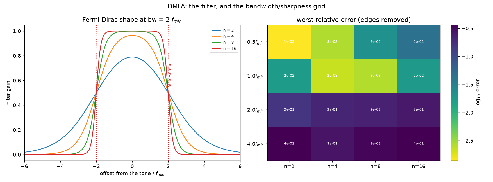
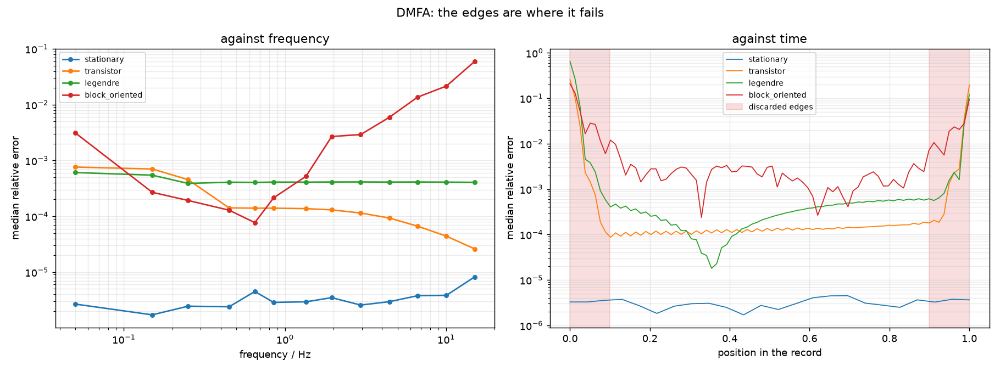

# DMFA

Demodulated multi-frequency analysis. Transform the whole record once; around
each excited tone, cut out a band with a passband filter; transform that band
back. What comes out is that tone's complex amplitude as a function of time,
and voltage over current is $Z(f,t)$.

Nothing is windowed, so the time resolution is not tied to the multisine
period — it is set by the filter bandwidth instead.

!!! warning "Provisional"
    This implementation reproduces the behaviour one expects of the method,
    but it has **not** been checked against the original description in the
    literature. Verifying it is an open item on the [roadmap](../roadmap.md).
    Treat DMFA results as provisional and cross-check them against STFT.

## The mathematics

### Definition

For a stationary system the impedance is simply the ratio of the transforms,

\[
Z(\omega) \;=\; \frac{\mathcal{F}[\Delta u](\omega)}{\mathcal{F}[i](\omega)}
\]

which has no time dependence at all. Koster *et al.* (2017) rewrite this with
an *apparent* time dependence by filtering and transforming back,

\[
Z(\omega) \;=\; \lim_{bw \to 0}
\frac{\mathcal{F}^{-1}\big[\Delta\tilde{u}(\omega')\,
       \tilde{g}(\omega'-\omega,\,bw)\big]}
     {\mathcal{F}^{-1}\big[\tilde{I}(\omega')\,
       \tilde{g}(\omega'-\omega,\,bw)\big]}
\tag{8}
\]

where $\tilde g$ is a filter centred on $\omega$ with bandwidth $bw$. As
$bw \to 0$ the result is constant in time and equals the stationary
impedance. **Dynamic** impedance is what you get by keeping the bandwidth
finite:

\[
Z'(\omega, t) \;=\;
\frac{\mathcal{F}^{-1}\big[\Delta\tilde{u}(\omega')\,
       \tilde{g}(\omega'-\omega,\,bw)\big]}
     {\mathcal{F}^{-1}\big[\tilde{I}(\omega')\,
       \tilde{g}(\omega'-\omega,\,bw)\big]}
\tag{9}
\]

This is the definition DEIStools implements. The bandwidth is the only thing
that creates the time dependence: it decides how much of each tone's skirt is
admitted, and the skirt is the time variation.

### Relation to STFT

The short-time Fourier transform is

\[
\mathrm{STFT}[x](\omega, t) = \int_{t-\Delta t/2}^{\,t+\Delta t/2}
  w(t'-t)\,x(t')\,e^{-\mathrm{j}\omega t'}\,\mathrm{d}t'
\tag{10}
\]

and the older definition of dynamic impedance is the ratio of two of these,

\[
Z'(\omega, t) \;=\;
\frac{\mathrm{STFT}[\Delta u](\omega, t)}{\mathrm{STFT}[i](\omega, t)}
\tag{11}
\]

Equations (9) and (11) are **the same thing** whenever the filter $\tilde g$
is the Fourier transform of the window $w$. DMFA and STFT are therefore not
rival methods but the same operation with the roles of windowing and
filtering exchanged — and, as Battistel and La Mantia (2019) put it, differing
only in the order the operations are performed:

| | STFT / FFT-EIS | DMFA |
|---|---|---|
| 1 | split the record into windows | transform the whole record |
| 2 | window each one | split the spectrum into bands |
| 3 | transform each one | filter each band |
| 4 | one spectrum per window | transform each band back |

Filters have more freedom of shape than window functions do, which is the
practical argument for (9) over (11).

### Quadrature filters

$\tilde g$ is a *quadrature* filter: it is defined only for positive
frequencies. Taking one side of the spectrum makes the inverse transform the
**analytic signal** — a complex envelope — rather than a real band-limited
signal, which is exactly what is wanted, since the envelope's magnitude and
phase are the amplitude and phase of the tone.

The simplest is rectangular,

\[
\tilde g(\omega'-\omega,\,bw) =
\begin{cases}
0 & \omega' < \omega - bw\\
1 & \omega - bw \le \omega' \le \omega + bw\\
0 & \omega' > \omega + bw
\end{cases}
\tag{13}
\]

but a hard edge rings badly in time. DEIStools uses the smooth version of
Battistel and La Mantia (2019), a product of two Fermi-Dirac functions
normalised to unit gain at the centre:

\[
\tilde g(\omega'-\omega,\,bw) \;=\;
\frac{\big[1+e^{-n}\big]^{2}}
     {\Big[1+e^{-n\frac{\omega'-\omega+bw}{bw}}\Big]
      \Big[1+e^{\;n\frac{\omega'-\omega-bw}{bw}}\Big]}
\tag{12}
\]

which simplifies to the form the code evaluates,

\[
\tilde g \;=\; \frac{\cosh n + 1}{\cosh n + \cosh\!\big(n\,x\big)},
\qquad x = \frac{\omega'-\omega}{bw}
\]

a flat top with a logistic roll-off, equal to $1/2$ at $x = \pm 1$. So `bw`
is the **half-amplitude half-width**, and `n` sets how sharply the filter
falls — the parameter swept in example 12.

### The bandwidth ceiling

`bw` cannot be chosen freely. It must be small enough that the band around
$\omega_k$ is not reached by the neighbouring tone $\omega_{k\pm1}$, nor by an
intermodulation $\omega_i \pm \omega_j$. Koster *et al.* give the limit in
terms of the minimum spacing $d$ designed into the multisine (in units of the
base frequency $f_b$):

\[
bw \;\le\; 2\pi f_b \frac{(d+1)}{2}
\]

A multisine designed with no minimum spacing, $d = 0$, allows only
$bw \le \pi f_b$ — which is why the frequency grid and the achievable time
resolution are the same decision. Their recommendation, from both simulation
and experiment, is $d = 7$.

### The Gabor limit

Underneath all of this is the uncertainty relation between time and frequency
resolution,

\[
\sigma_t \, \sigma_f \;\ge\; \frac{1}{4\pi}
\tag{1}
\]

No method escapes it. STFT, DMFA, the lock-in and BLTVA simply offer different
ways to spend the same budget.

## Calling it

DMFA is assembled from four functions rather than called as one.

```python
import numpy as np
from numpy.fft import fft, fftshift, fftfreq
from deistools.processing.dmfa_functions import (
    extract_impedance, max_elaboration_points,
    elaboration_frequency_axis, elaboration_time_axis)
from deistools.processing.passband_filters import create_fermi_dirac_fun

# 1. transform the whole record, zero frequency in the middle
ft_voltage = fftshift(fft(voltage)) / N
ft_current = fftshift(fft(current)) / N
spectrum_axis = fftshift(fftfreq(N, 1.0 / fs))

# 2. the bin of each excited tone
index_f0 = int(np.argmin(np.abs(spectrum_axis)))
indexes = (np.round(frequencies * T).astype(int) + index_f0).tolist()

# 3. the passband, on the band's LOCAL frequency axis
bandwidth = 0.5 * frequencies.min()
n_points = min(int(round(8 * bandwidth * T)),
               max_elaboration_points(indexes, N))
band_axis = elaboration_frequency_axis(n_points, T)
band_filter = create_fermi_dirac_fun(band_axis, 0, bandwidth, 2)

# 4. extract and divide
Z = extract_impedance(ft_voltage, ft_current, indexes, band_filter, n_points)
t = elaboration_time_axis(n_points, T)
```

!!! danger "Build the filter on the local axis"
    `elaboration_frequency_axis(n_points, T)` spans `n_points` bins of width
    $1/T$ — about 0.2 Hz in the example above. The full spectrum axis spans
    $f_s$, which is 1000 Hz. Build the filter on the wrong one and its
    bandwidth is wrong by a factor of $f_s T / n_{\text{points}}$ — 2500 here.
    This is the easiest mistake to make with this method.

## The two parameters

### Bandwidth

Wider bands give finer time resolution and admit more of the neighbouring
tone. The useful unit is $f_{\min}$, because in DFT bins $f_{\min}$ is exactly
$P$ bins, and the closest pair of tones on a quasi-log odd grid sits
$2f_{\min}$ apart.

So a passband of $2f_{\min}$ is already reaching its neighbour.

| bandwidth | instants | median | worst (edges removed) |
|---|---|---|---|
| 0.5 $f_{\min}$ | 80 | 1.35e-04 | 2.20e-02 |
| 1.0 $f_{\min}$ | 160 | 1.01e-04 | 2.66e-03 |
| 2.0 $f_{\min}$ | 320 | 9.31e-05 | 2.19e-01 |
| 4.0 $f_{\min}$ | 640 | 1.04e-04 | 3.39e-01 |

*(transistor system, sharpness $n = 8$; example 12)*

The median barely moves while the worst case moves by two orders of
magnitude. **Judge DMFA settings by the worst case, not the median** — the
leakage shows up as a large error at a few instants, not a small error
everywhere. Selecting on the median here would pick $2f_{\min}$, whose worst
case is 158× poorer than the best setting.

### Sharpness

`n` is the Fermi-Dirac exponent; large `n` approaches a brick wall. It has to
be matched to the bandwidth, because there are two opposite failure modes:

- **Wide band, gentle filter** — the passband reaches the neighbouring tone
  and leakage dominates.
- **Narrow band, sharp filter** — the band is truncated abruptly, so its
  inverse transform rings in time. At $0.5f_{\min}$ the worst case grows from
  1.4e-03 at $n=2$ to 4.5e-02 at $n=16$, with no neighbouring tone anywhere
  near the passband to blame.

An ideal passband is the $n \to \infty$ corner, and that corner is a bad place
to be. This is why the filter is parameterised with an adjustable `n`.

!!! tip "A standard DSP window does better than the published filter"
    The Fermi-Dirac comes from statistical physics. Scored against known
    ground truth on three systems it ranks **last of seven** candidates, with
    Blackman about twice as good on the worst case. It remains the default
    because it is what the papers specify; `create_window_filter` switches to
    any of `blackman`, `blackman-harris`, `nuttall`, `hann`, `kaiser` or
    `gaussian` in one line. The measurement is in
    [the implementation notes](../implementation/dmfa.md#is-the-fermi-dirac-filter-the-right-choice-no)
    and example 12 re-runs it.



*Left: the Fermi-Dirac passband at four sharpnesses, with the nearest tone
marked. Right: worst relative error over the grid — the best settings lie on a
diagonal, not at a corner.*

## The record edges are unusable

The band-limited inverse transform rings at the record boundaries. **Discard
the first and last tenth of every DMFA result.** This is not optional and no
setting removes it:

| | worst, edges removed | worst, edges kept |
|---|---|---|
| transistor | 1.39e-03 | 4.13e-01 |
| legendre | 1.33e-03 | 8.85e-01 |

!!! tip "This is now fixable"
    The edge damage is circular wrap-around, and zero-padding the record
    before the transform removes 24-29x of it at no cost to the interior.
    See [another way to apply the filter](#another-way-to-apply-the-filter).

The stationary system shows **no difference at all**, which is the proof of
what causes the rings: a constant impedance occupies a single bin, so
truncating the band removes nothing and there is nothing to ring. The artefact
is the cost of representing a *changing* quantity with a finite band, not an
artefact of the record ending.



*Right: error against position in the record. The three time-varying systems
show the same U shape; the stationary one is flat to both ends.*

## Is the operation safe? The division, and the truncation

Two separate worries, with two different answers.

### The division is safe, and it is not where the ringing comes from

The concern is natural: $Z = \mathcal{F}^{-1}[\tilde V \tilde g] \big/
\mathcal{F}^{-1}[\tilde I \tilde g]$ divides one reconstructed signal by
another, and if the denominator ever approaches zero the result explodes.

It does not, and the reason is structural. In a **galvanostatic** measurement
the current is the excitation: exactly periodic, so its spectrum near $f_k$ is
a single line with **no skirt**. Filtering a single line gives a constant. The
denominator is therefore constant by construction, not merely small-varying:

| | measured |
|---|---|
| variation of $\|I_{\text{filtered}}\|$ over the record | 4.5e-03 |
| $\min\|I_f\| / \mathrm{mean}\|I_f\|$ | 0.9936 |
| same, with 1e-4 A of current noise added | 0.9934 |

Replacing $I_f(t)$ by the single constant $I_f(T/2)$ changes the error nowhere
by more than 1e-2 absolute — at the edges, where the error is 0.26 anyway.
**The ringing is entirely in the numerator**: it is the band-limited
reconstruction of the voltage envelope, and the division neither creates nor
amplifies it.

!!! note "This is why Chukwu *et al.* compute the admittance"
    Their measurements are potentiostatic, so for them the *voltage* is the
    clean excitation and the current carries the skirt. Taking
    $Y = I/V$ rather than $Z = V/I$ keeps the clean signal in the denominator.
    The rule is general: **put the excitation in the denominator**, then
    invert at the end if you want the other quantity.

### Most of the spectrum is discarded, and that is the point

Also true that almost everything is zeroed: on the standard grid the extracted
bands are **0.78% of the bins**. But they hold about a third of the record's
total energy — more than half of the positive-frequency half — because the
bins that are kept are exactly where the signal is. The rest is the other
tones, the harmonics, the trend near DC and the noise floor.

Zeroing them is selection, not loss. The excited line plus its skirt *is* the
entire information about that tone's time-varying amplitude.

### What is unsafe is the wrap-around

The genuine problem is neither of those. Multiplying a spectrum by a filter is
a **circular** convolution in time. The kernel that reaches past the end of
the record wraps around and picks up the beginning — and on a time-varying
system the two ends are different. On the transistor record, $|Z|$ at the
lowest tone runs from 106 Ω at $t=0$ to 43 Ω at $t=T$, so the estimate near
either boundary is contaminated by a value 2.4× away.

That, and not the division, is the edge oscillation.

## Another way to apply the filter

Three alternatives were tried against known ground truth.

### Zero-padding — works, and is the recommended fix

Padding the record before the transform makes the convolution linear: the
kernel then runs into zeros instead of into the far end.

| system | worst, plain | worst, padded | median |
|---|---|---|---|
| transistor | 7.5e-01 | **3.2e-02** | unchanged (0.99×) |
| legendre | 8.8e-01 | **3.1e-02** | unchanged (0.99×) |

**24× to 29× on the worst case, with the interior untouched** — as it must be,
since the kernel never reaches that far.

It works better than "assume the signal is zero outside" has any right to, and
the reason is the structure above: the padding attenuates the **numerator and
the denominator by the same factor**. At the first instant the filtered
current falls to 0.49 of its mid-record value and the filtered voltage falls
with it, so the ratio survives. Zero-padding costs signal-to-noise near the
edges, not accuracy.

`pad_record` does it:

```python
from deistools.processing.dmfa_functions import pad_record

ft_voltage = fftshift(fft(pad_record(voltage))) / n_padded
```

The padding must be at least the kernel length, $\approx 1/bw$; doubling the
record is ample.

### Time-domain filtering — better at the edges, worse in the middle

The [lock-in](lock-in.md) demodulates first and filters in the time domain,
where the boundary can be handled explicitly by reflecting the smooth baseband
envelope. No circularity arises at all. Matched to the same 20 s resolution:

| position in record | DMFA (circular) | lock-in (time domain) |
|---|---|---|
| 0% | 2.6e-01 | **4.4e-03** |
| 25% | **9.8e-05** | 7.2e-04 |
| 50% | **1.2e-04** | 9.3e-04 |
| 100% | 3.9e-01 | **1.6e-02** |
| worst overall | 7.5e-01 | **6.0e-02** |

A clean trade: the lock-in is 25–60× better at the boundaries, DMFA about 7×
better in the interior, because a boxcar integrator has poorer frequency
selectivity than a smooth filter of the same bandwidth.

There is a reason you cannot simply reflect the *record* and get the lock-in's
behaviour out of DMFA: reflecting a random-phase multisine destroys the
carrier (see
[mirroring](../implementation/dmfa.md#mirroring-must-not-be-used-with-a-random-phase-multisine)).
A carrier-preserving reflection has to act on the baseband envelope, which
means demodulating first — and once you have demodulated, you are running a
lock-in. The two facts are the same fact.

### Envelope detrending — tried, and it does not work

The idea: the envelope is non-periodic, so subtract the linear ramp that makes
it periodic, filter, then add the ramp back. Measured, it is far worse —
median 1.3e-04 → 1.2e-01, with 97% of the record above 1e-02 instead of 6%.

The reason is instructive. The ramp's own spectrum is not band-limited; it is
a broad skirt. Subtracting it in the time domain removes all of it, but the
band extraction only puts back the part inside the band, so adding the full
analytic ramp back over-corrects. Adding back the *filtered* ramp instead
makes the whole procedure an identity. The approach is circular, and no
arrangement of it escapes that.

### In short

Use **zero-padding**. It is one line, it costs nothing in the interior, and it
removes the mechanism rather than compensating for it. Reach for the lock-in
when the first or last few percent of the record is what you actually care
about.

## Trends: why BLTVA's detrending does not transfer

BLTVA handles a trend by **differencing**: the filter $F_d(k) = (1-z_k^{-1})^d$
is applied to the data, the *regressors are filtered with it too*, the rows
are reweighted by $1/|F|$ to undo the colouring it imposes on the noise, and
boundary regressors absorb the startup transient. Four coupled pieces.

None of them has a counterpart in DMFA, because DMFA has **no model to
filter and no weighting to restore**. It does not estimate the trend; it
rejects it. And since it forms a *ratio* of two filtered signals, any filter
applied to both channels largely cancels:

| differencing order, applied to **both** channels | median error |
|---|---|
| 0 | 1.315e-04 |
| 1 | 1.308e-04 |
| 2 | 3.229e-04 |
| 3 | 5.263e-04 |

The median barely moves at $d=1$ — the common factor divides out — and
degrades beyond it. The reason it is not *exactly* a no-op is that $F(k)$
varies across the band, so it reshapes the passband rather than scaling it.
Near dc that variation is steep, which is why the lowest tone is the one it
disturbs: differencing costs it 6.7e-03 **even with no trend present**.

### What a trend actually does

Only one tone is at risk. With a 5 V peak-to-peak order-3 trend on a 1.53 V
signal:

| | lowest tone | median over all tones |
|---|---|---|
| no trend | 2.1e-04 | 1.315e-04 |
| with trend | **2.9e-01** | 1.319e-04 |

A factor of 1400 on the lowest tone and nothing anywhere else. A trend lives
at dc, so it reaches the band around $f_k$ only through the filter's
stopband, and every tone above the first is further away.

### DMFA's actual knob: stopband rejection at dc

For the tone at $f_k$ the trend sits $f_k$ from the band centre, so what
matters is the filter's gain there. Varying nothing else:

| filter | rejection at $f_{\min}$ | error, lowest tone |
|---|---|---|
| Fermi-Dirac n = 2 | 18 dB | 2.9e-01 |
| Fermi-Dirac n = 4 | 35 dB | 3.6e-02 |
| **Fermi-Dirac n = 8** | **69 dB** | **1.4e-03** |
| Fermi-Dirac n = 16 | 139 dB | 2.1e-02 |
| blackman | 29 dB | 6.8e-02 |
| nuttall | 27 dB | 8.8e-02 |

**A 211× improvement from changing one parameter.** `rejection_db` reports
the number.

Two things in that table are worth dwelling on.

Rejection buys accuracy only until the filter's own ringing takes over:
`n = 16` has 70 dB more than `n = 8` and is 15× worse, because at that
sharpness it rings. There is an optimum, and it is not at the extreme.

And **a trend reverses the filter ranking**. The compactly supported windows
won the [trend-free comparison](../implementation/dmfa.md#is-the-fermi-dirac-filter-the-right-choice-no),
but they reach only about 30 dB at $f_{\min}$, where the Fermi-Dirac's
exponential tail reaches 69. Blackman is the better filter on a clean record
and 48× worse on this one. Choose against the trend you expect, not against a
clean simulation.

### The full ladder

| approach | lowest tone | vs doing nothing |
|---|---|---|
| nothing (n = 2) | 2.9e-01 | — |
| differencing, d = 1 | 1.0e-02 | 28× |
| subtract an order-3 polynomial first | 4.7e-03 | 61× |
| filter n = 8 | 1.4e-03 | 211× |
| **n = 8 + subtract the polynomial** | **1.6e-04** | **1800×** |
| *no trend at all, n = 8* | *1.5e-04* | *(the floor)* |

The combination reaches the trend-free floor exactly. Note the ordering:
**differencing is the weakest of the three**, which is the opposite of its
standing in BLTVA — there it reduces the number of trend parameters, and here
there are none to reduce.

### When the dc skirt reaches several tones

The single-tone case above is the easy one. In a real measurement the trend is
large and the record is short, and then the skirt swallows the bottom of the
grid. With a 48 V peak-to-peak drift on a 1.53 V signal over 8 periods:

| tone | f / Hz | trend/signal at that bin | error, no trend | error, with trend |
|---|---|---|---|---|
| 0 | 0.05 | 2.6 | 4.3e-03 | 8.3e-01 (193×) |
| 1 | 0.15 | 0.86 | 5.5e-03 | 1.8e-01 (33×) |
| 2 | 0.25 | 0.51 | 5.7e-03 | 1.1e-01 (19×) |
| 3 | 0.45 | 0.29 | 4.9e-03 | 5.2e-02 (11×) |
| 4 | 0.65 | 0.21 | 4.5e-03 | 4.4e-02 (10×) |
| 5 | 0.85 | 0.16 | 4.7e-03 | 3.0e-02 (6×) |

Six tones compromised, not one. Raising the filter's stopband rejection no
longer saves you, because the trend is not leaking in through the skirt of the
filter — it is **sitting in the same bins as the signal**.

### Why no filter can fix this

A filter is diagonal in frequency: it multiplies bin $k$ by $g_k$. The trend's
contribution $T(k)$ and the signal's $S(k)$ are both in bin $k$, so any filter
scales them **together** and the ratio $T(k)/S(k)$ is untouched. That is a
property of the operation, not of the particular filter, and it is why
differencing measured as the weakest option: differencing is also diagonal.

Subtracting a polynomial in the time domain is not diagonal and does help —
but it removes signal along with the trend, and DMFA has no way to know how
much. Measured by applying the same subtraction to a record with **no trend**,
so that everything removed is signal:

| trend-model order | distortion at tone 0 | at tone 1 | at tone 2 |
|---|---|---|---|
| 1 | 2.1e-03 | 4.5e-04 | 2.4e-04 |
| 3 | 5.9e-03 | 1.4e-03 | 7.3e-04 |
| 8 | 3.7e-02 | 3.3e-03 | 1.5e-03 |
| 12 | 6.3e-02 | 6.1e-03 | 2.2e-03 |

Against a clean error of 4.3e-03 at tone 0, an order-3 subtraction already
costs more than the measurement is worth, and an awkward trend needing order 8
or 12 costs an order of magnitude more. **This is the real limitation**: the
detrending distorts, the distortion grows with the trend order, and the filter
formulation offers nothing to correct it with.

### The fix: estimate the trend and the envelope together

DMFA [is least squares in a Fourier basis](../implementation/dmfa.md#dmfa-as-linear-algebra-it-is-bltva-in-a-different-basis).
Once that is seen, the fix is the obvious one and the same one BLTVA uses:
**put the trend in the design matrix** and solve for it alongside the envelope
coefficients.

\[
v(t) \;=\; \underbrace{\sum_{j=0}^{q} a_j\,b_j(t)}_{\text{trend}}
\;+\; \sum_k \mathrm{Re}\Big\{
\underbrace{\textstyle\sum_m c_{k,m} e^{\mathrm{j}2\pi m t/T}}_{\text{envelope}}
e^{\mathrm{j}\omega_k t}\Big\} \;+\; \text{noise}
\]

The trend columns and the band columns are **not** orthogonal — that
non-orthogonality *is* the overlap problem — and a joint solve handles it
exactly, paying the usual price of collinearity in variance rather than in
bias. The filter is not lost: it reappears as a ridge penalty
$\lambda_m = 1/g_m - 1$ on the band columns and none on the trend columns.

Measured on the same six-tone case:

| tone | no trend | trend, plain DMFA | trend, subtract first | **trend, joint ridge** |
|---|---|---|---|---|
| 0 | 4.27e-03 | 8.26e-01 | 8.04e-03 | **4.73e-03** |
| 1 | 5.50e-03 | 1.81e-01 | 6.28e-03 | **5.46e-03** |
| 2 | 5.72e-03 | 1.06e-01 | 5.61e-03 | **5.63e-03** |
| 3 | 4.86e-03 | 5.20e-02 | 4.91e-03 | **4.88e-03** |
| 4 | 4.45e-03 | 4.42e-02 | 4.47e-03 | **4.46e-03** |
| 5 | 4.72e-03 | 2.96e-02 | 4.67e-03 | **4.68e-03** |

The joint fit returns every tone to its trend-free value. Subtraction leaves a
residual distortion at the lowest tone — 8.0e-03 against a floor of
4.3e-03 — and the joint fit does not.

!!! note "Where this leaves the two methods"
    The fix for DMFA's trend problem is to use its least-squares form with
    trend regressors — at which point it differs from BLTVA only in the basis
    chosen for the envelope, Fourier against Legendre. That is not a
    coincidence or a defeat; it is the same observation from the other side.
    A filter can reject a disturbance that lives somewhere else in frequency.
    Separating two things that occupy the same bins needs a *model*, and
    adding one is what turns a filter bank into an estimator.

    **Not implemented.** A dense solve does not scale -- 13 tones on a 400 s
    record is a 400000 x 2110 design matrix -- but the structure is friendly:
    the tone blocks are mutually orthogonal and couple only to the trend
    block, so the normal equations are block-arrow and can be formed by FFT.
    It is on the [roadmap](../roadmap.md).

    Until then, on a record whose trend reaches the bottom of the grid, use
    **BLTVA for the lowest few tones**. It already solves this problem, and
    `Nq` is the parameter that does it.

### In practice

1. **Pick the filter for the rejection you need.** `rejection_db(g, axis,
   f_min)` tells you what you have. On this record 69 dB was enough and 18 dB
   was not.
2. **Subtract a smooth trend before the transform** if one is visible. This is
   safe in a way it is not for BLTVA: a smooth polynomial has energy only near
   dc, so removing it does not touch the bands. Match the order to the trend —
   order 3 scored 4.7e-03 here, and going to 5 or 8 was slightly *worse*,
   since the extra freedom starts removing signal.
3. **Or raise the lowest excited frequency**, which moves the first band
   further from dc and costs nothing but time resolution.
4. **Check whether the skirt has reached the bottom of your grid at all.**
   Compare the trend's magnitude at each excited bin with the signal's. If
   the ratio exceeds a few tenths at more than the lowest tone, none of the
   above is enough and the section above applies: use BLTVA for those tones,
   or wait for the joint solve.

What you should *not* do is reach for differencing because BLTVA uses it. The
two methods are solving different problems with the same word.

## Inspecting a fit

```python
from deistools.processing.dmfa_functions import visualize_dmfa_filtering

visualize_dmfa_filtering(band_filter, ft_voltage, ft_current,
                         spectrum_axis, list(frequencies), indexes)
```

A slider pages through the excited tones, showing the raw band, the filtered
band and the filter itself, for voltage and for current. It is the first thing
to open when a DMFA result looks wrong: a band that is visibly clipped, or one
with a neighbouring tone inside the passband, explains more than any residual
number.

## When to use it

- You want time resolution decoupled from the multisine period. DMFA's is set
  by the bandwidth, so it is adjustable — but see the caveat below: at the
  bandwidth that measures best here, the *independent* spacing works out the
  same as STFT's one-period window. Finer costs accuracy.
- You want a method that, like STFT, assumes nothing about the *form* of the
  variation.
- As a cross-check on BLTVA, whose accuracy depends on an assumption DMFA does
  not make.

Given the provisional status above, do not use DMFA alone for a result you
intend to publish.
