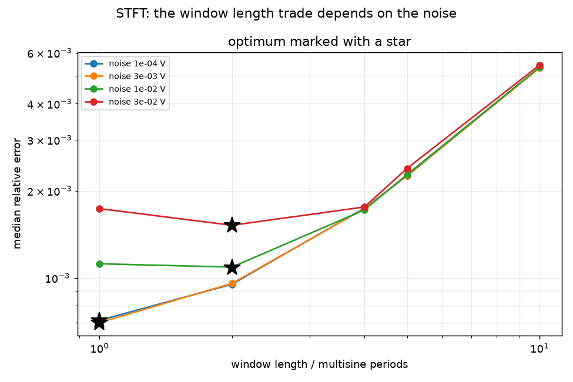

# STFT

Short-time Fourier estimation. Cut the record into consecutive windows, take
the DFT of each, divide voltage by current at the excited bins. Each window
gives one spectrum, stamped at its own midpoint.

It is the method with nothing to assume and almost nothing to tune, which
makes it the right first thing to try and the right fallback when the others
fail.

## Calling it

```python
from deistools.processing.stft_functions import estimate_impedance

Z, voltage_avg, current_avg, t = estimate_impedance(
    voltage,            # measured response
    current,            # measured excitation
    frequencies,        # the excited frequencies [Hz]
    period,             # window length in SECONDS
    sampling_time,      # 1/fs
    window_fun="rectangular",
)
```

| returned | shape | meaning |
|---|---|---|
| `Z` | `(n_freq, n_windows)` | the impedance in each window |
| `voltage_avg` | `(n_windows,)` | mean voltage in each window |
| `current_avg` | `(n_windows,)` | mean current in each window |
| `t` | `(n_windows,)` | midpoint of each window, in seconds |

`voltage_avg` and `current_avg` carry no impedance information, but a drifting
`voltage_avg` is a direct warning that the cell is doing something besides
responding to your excitation.

!!! warning "`period` is in seconds"
    Not samples, and not multisine periods. It must hold a whole number of
    periods of every tone, or the rectangular window leaks.

## The one parameter

The window length fixes three things at once: the time resolution (one
estimate per window), how much noise is averaged away, and how much the
impedance is smeared by varying *within* a window.

Shorter windows track better and average less. Which wins depends on the
noise:

| noise | 1 × $T_p$ | 2 × $T_p$ | 4 × $T_p$ | best |
|---|---|---|---|---|
| $10^{-4}$ V | 7.1e-04 | 9.5e-04 | 1.7e-03 | 1 × $T_p$ |
| $10^{-2}$ V | 1.1e-03 | 1.1e-03 | 1.7e-03 | 2 × $T_p$ |
| $3\times10^{-2}$ V | 1.7e-03 | 1.5e-03 | 1.8e-03 | 2 × $T_p$ |

*(median relative error on the transistor system; example 10)*



With a strong excitation the shortest window wins. On a real cell with a small
excitation the optimum moves out, and the choice becomes a real decision
rather than "use the shortest".

On a **stationary** system the bias term is identically zero, so the trade has
only one side: the whole record in one window is best. If a window sweep picks
the longest window, that is itself a useful signal about your cell.

## Limits

- **Time resolution cannot go below one multisine period.** The lowest tone
  would not fit in a shorter window. This is a hard floor.
- **The skirts are not used.** All the information about how the system changed
  between windows is discarded.
- **No uncertainty** from the excited bins alone. A window of two or more
  multisine periods *does* carry it, in the bins this estimator discards — see
  [BLA per burst](bla.md), which reads the noise and nonlinear distortion off
  them. The catch is in the window length: at one period every bin is a
  harmonic of the multisine and the separation is impossible, so the error
  bars cost at least half the time resolution.

## When to use it

- Your variation is not smooth — a step, a kink, anything a low-order
  polynomial cannot follow. STFT will track it; BLTVA will not.
- You want a result that depends on as few assumptions as possible.
- As a cross-check on the others. In example 20 all three agree to within a
  factor of three on a stationary cell; a disagreement there would point at a
  problem with the setup, not the physics.

## Failure mode

The error concentrates at the **lowest** tones, where a window holds only one
or two cycles and whatever the cell did during that window is baked into them.
If a result is worst at the bottom of the grid and improves monotonically
upward, that is the within-window bias and a shorter window is the remedy —
if the noise allows it.
